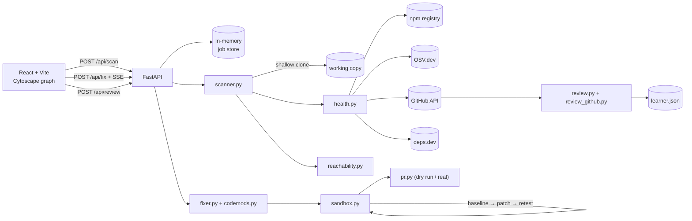

# Ghost Maintainer

[](file:///backend)
[](file:///frontend)
[](file:///frontend)
[](file:///backend)
[](LICENSE)

> **Autonomous open-source dependency maintenance & AI PR review engine.**
> Finds rotten npm dependencies, verifies code reachability, applies deterministic AST codemods, proves fixes in an isolated sandbox with the project's own test suite, and previews/opens ready-to-merge Pull Requests.

Ghost Maintainer ships two core engines sharing one unified dashboard:

1. **Autonomous Dependency Fixer** — Scan → 5-factor Rot Score → Reachability analysis → Migration / Safe bump → Sandboxed test verification → Pull Request preview & creation.
2. **AI Pull-Request Reviewer** — 4 specialized agents (Static, Security, Architecture, Style) reviewing code diffs, backed by persistent repository memory (`learner.py`) to prevent repeat anti-patterns.

Everything works with **no LLM key** and **no GitHub token** required for offline demos and local development. Tokens unlock live GitHub PR creation and enhanced model-driven review insights.

---

## Why it is not Dependabot

Dependabot bumps versions. Ghost Maintainer answers three questions it cannot:

- **Is this package abandoned?** The Rot Score rates staleness, deprecation, advisory severity, maintainer inactivity and major-version lag — not only known CVEs.
- **Does my code actually touch it?** A source scan reports where a package is imported, with file and line evidence, and separates "observed" from "not observed".
- **Did the fix break anything?** Every fix runs the project's own tests in an isolated workspace before any pull request exists.

It also never claims more than it knows: an unimported package is reported as `not_observed`, never as "safe" or "unreachable".

---

## Architecture



**Backend layout**

```text
backend/app/
  main.py            FastAPI app, CORS, /health
  api.py             scan, fix, review, webhook routes + SSE
  config.py          every setting, with safe defaults
  models.py          typed contracts for the whole pipeline
  scanner.py         repository resolution, manifest + lockfile parsing
  semver_utils.py    version parsing and comparison
  health.py          npm / OSV / GitHub / deps.dev clients, caching, fixture fallback
  rot_score.py       the five-component Rot Score
  reachability.py    import and require detection
  fixer.py           safe bumps, replacement planning
  codemods.py        deterministic moment→dayjs and request→axios transforms
  swaps.json         curated replacement mappings
  sandbox.py         docker + local-restricted runners, diff generation
  pr.py              PR title/body, dry run, real GitHub PR creation
  pipeline.py        scan and fix orchestration
  jobs.py            in-memory job store with log streaming
  review.py          four review agents, diff parsing, LLM validation
  review_github.py   fetch a PR diff, post inline comments
  webhook.py         HMAC verification, event parsing, dedupe
  learner.py         repository-specific pattern memory
  llm.py             provider-agnostic LLM wrapper
  fixtures/          captured npm / OSV / GitHub payloads for offline demos
```

---

## Prerequisites

- **Node.js 20+** (built and verified on 24.21)
- **Python 3.11+** (verified on 3.11.7 — on Windows use `python`, not `py`, which resolves to 3.9)
- **uv** for the backend virtualenv
- **Git**
- **Docker Desktop** (optional but recommended for the sandbox)

---

## Installation

```powershell
# Backend
cd backend
uv venv .venv --python 3.11
uv pip install --python .venv\Scripts\python.exe -r requirements.txt
Copy-Item .env.example .env

# Frontend
cd ..\frontend
npm install

# Demo repository
cd ..\demo-rotten-app
npm install
```

---

## Running it

The fastest path, which also waits for both servers and opens the dashboard:

```powershell
.\scripts\demo.ps1
```

Or start them by hand in two terminals:

```powershell
# terminal 1
cd backend
.venv\Scripts\python.exe -m uvicorn app.main:app --reload --port 8000
```

```powershell
# terminal 2
cd frontend
npm run dev
```

Open **http://localhost:5173** (use `localhost`, not `127.0.0.1` — Vite binds the IPv6 loopback on Windows).

Check the backend at `http://localhost:8000/health` and the interactive API docs at `http://localhost:8000/docs`.

---

## Configuration

All settings live in `backend/app/config.py` and can be set in `backend/.env`:

| Variable | Default | Purpose |
|---|---|---|
| `GITHUB_TOKEN` | empty | Raises API limits; required only for real PRs and posting reviews |
| `GITHUB_WEBHOOK_SECRET` | empty | Verifies webhook deliveries. Unsigned deliveries are rejected when set |
| `DRY_RUN` | `true` | `true` performs no GitHub write requests at all |
| `LLM_API_KEY` / `LLM_MODEL` / `LLM_BASE_URL` | empty | Optional. Any OpenAI-compatible provider |
| `SANDBOX_MODE` | `auto` | `auto`, `docker`, or `local_restricted` |
| `ALLOW_UNTRUSTED_LOCAL_EXECUTION` | `false` | Explicit consent for the non-container fallback |
| `SANDBOX_TIMEOUT_SECONDS` | `180` | Hard limit per test command |
| `OFFLINE_FIXTURES` | `false` | Force captured npm/OSV/GitHub data instead of live calls |
| `FRONTEND_ORIGIN` | `http://localhost:5173` | CORS origin |

`VITE_API_BASE_URL` (frontend, default `http://localhost:8000`) points the dashboard at the API.

### The LLM is optional

No key is needed for anything the demo does. With `LLM_API_KEY` empty you still get scanning, Rot
Scores, reachability, safe bumps, both codemods, the sandbox test run, the PR preview and all four
review agents (their deterministic rules). A key adds exactly two things: model-assisted review
findings, and LLM-proposed migrations on top of the deterministic ones.

Verify whichever provider you choose with one command:

```powershell
cd backend
.venv\Scripts\python.exe -m app.llm_check
```

It prints the resolved endpoint and model, masks the key, and — if one is configured — sends a probe
request. Any OpenAI-compatible endpoint works. Free tiers verified against the provider endpoints in
October 2026, none requiring a credit card:

| Option | `LLM_BASE_URL` | `LLM_MODEL` | Get a key |
|---|---|---|---|
| Groq | `https://api.groq.com/openai/v1` | `llama-3.3-70b-versatile` | console.groq.com/keys |
| Cerebras | `https://api.cerebras.ai/v1` | `llama3.1-70b` | cloud.cerebras.ai |
| Mistral | `https://api.mistral.ai/v1` | `open-mistral-7b` | console.mistral.ai |
| Google Gemini | `https://generativelanguage.googleapis.com/v1beta/openai` | `gemini-3.6-flash` | aistudio.google.com/app/apikey |
| OpenRouter | `https://openrouter.ai/api/v1` | `nvidia/nemotron-3-ultra-550b-a55b:free` | openrouter.ai/keys |
| LLM7.io | `https://api.llm7.io/v1` | `gpt-oss-20b` | token.llm7.io |
| Ollama, fully local | `http://localhost:11434/v1` | `qwen2.5-coder:7b` | none |

Two notes that save time:

- **A Gemini free-tier key that hits its limit is usually a daily quota, not a dead key.** It resets,
  and a second AI Studio project gets its own quota. If you need something right now, Groq is the
  fastest signup of the hosted options.
- **GitHub Models is not an option.** GitHub retired the inference API on 30 July 2026, so the old
  `models.github.ai/inference` base URL no longer works.

Ollama is the only route with no account and no key: install it, run
`ollama pull qwen2.5-coder:7b`, and set `LLM_API_KEY=ollama` (the value is ignored).

---

## The three-minute demo

A shot-by-shot script with timings and recovery notes is in **`DEMO.md`**. The short version:

**0:00–0:30 — Discover risk.**
Open the dashboard and press **Demo repo**. The scan resolves 7 direct dependencies from the lockfile,
shows 2 rotten, 3 aging, 2 healthy, and colours the graph accordingly.

**0:30–1:00 — Explain the risk.**
Select `jsonwebtoken`. Its Rot Score is 90: stale release, deprecated on npm, four advisories
including a critical, and three major versions behind. The reachability panel shows **not observed** —
no source file imports it — and explains that this does not prove it is unreachable. Then select
`lodash`: 48, six advisories, and three real call sites with file and line numbers.

**1:00–2:00 — Remediate.**
With `lodash` selected, press **Adopt fix**. Watch the pipeline: baseline tests, patch, post-fix
tests. It runs in about 16 seconds because the sandbox reuses the working copy's installed
dependencies instead of reinstalling from scratch.

**2:00–2:40 — Prove it.**
Show the diff and the passing test evidence side by side. Then choose `moment` and adopt the **package
replacement** instead of the bump: `package.json` and `src/dates.js` change, `dayjs` is installed, and
the same 21 tests still pass.

**2:40–3:00 — Prepare the PR.**
Show the generated PR body: version change, Rot Score breakdown, advisory table, reachability evidence
with limitations, files changed, baseline and post-fix results, and the footer. It is a dry-run
preview, clearly labelled, with no fake URL.

**If an external API is down during judging:** run `.\scripts\demo.ps1 -Offline`. The scan then uses
captured npm/OSV/GitHub payloads and produces identical findings with no network calls. Keep a
recording as the final fallback.

---

## Enabling a real pull request

Dry run is the default and performs zero write requests. To open a real PR:

1. Push a copy of `demo-rotten-app/` to a repository you own (see `demo-rotten-app/README.md`).
2. Create a token with `repo` scope.
3. In `backend/.env`:

   ```env
   GITHUB_TOKEN=ghp_...
   DRY_RUN=false
   ```

4. Scan `https://github.com/<you>/<repo>` and adopt a fix.

The PR is opened only when the baseline **and** the post-fix tests pass, the plan does not require human review, and the token has push permission. A failed fix can never produce a pull request.

---

## Feature 2: reviewing a pull request

- **Manual**: open the **PR review** tab, enter `owner/repo#123`, press Review.
- **Webhook**: point a GitHub webhook at `/api/webhook/github`, subscribe to *Pull requests*, set the same secret in `GITHUB_WEBHOOK_SECRET`, and expose the API through a tunnel (`ngrok http 8000`).

Four agents run: static analysis, security, architecture and style. Every agent has deterministic rules that always run, so the reviewer works with no LLM key. With a key, model findings are added only after they are validated against the diff — a path or line that was not changed is dropped.

The **style agent respects repository conventions**: a file that already uses `var` everywhere does not get `var` findings. Without that, a review of express flagged 16 `var` lines and nothing else.

Posting is gated the same way as PR creation: dry run by default, so the review is shown but not sent.

---

## Security model

What is genuinely enforced:

- Repository code is never executed in the backend process.
- The **Docker runner** uses a disposable container with `--network none` for tests, a memory cap, a CPU cap, a PID limit, and only the temporary workspace mounted.
- The **local runner** scrubs the environment (no `GITHUB_TOKEN`, no LLM keys), disables npm lifecycle scripts, uses argument lists rather than a shell, enforces a wall-clock timeout, and kills the whole process tree on timeout.
- The local runner **is not a security boundary**. It requires `ALLOW_UNTRUSTED_LOCAL_EXECUTION=true` and the UI labels it as such.
- Paths from a fix plan are rejected if they resolve outside the workspace.
- Package names and repository inputs are validated before use.
- Webhook deliveries are HMAC-verified when a secret is configured.
- No credentials are ever committed; `.env` is ignored.

What is **not** claimed:

- A `not_observed` result is not proof that a package is unreachable.
- A Rot Score of 0 does not mean a package is safe.
- An advisory match is not proof of exploitability.
- The local fallback is not isolation.

---

## Known limitations

- **Direct dependencies only.** Transitive dependencies are not enumerated.
- **JavaScript/TypeScript only.** Python, Go and Rust are not supported yet.
- **Two migrations are supported** (`moment→dayjs`, `request→axios`) plus safe same-major bumps. `left-pad` and `querystring` are documented in `swaps.json` but refused rather than rewritten.
- **Cross-major upgrades are never automatic.** They are offered with a review flag.
- **Reachability is a heuristic.** Dynamic imports built from variables, path aliases and unsupported file types are invisible to it.
- **The job store is in memory.** Restarting the backend discards jobs and working copies.
- **The learner is a JSON file**, not a database.
- **No authentication.** This is a single-user hackathon build; do not expose it publicly as-is.
- **Docker is required for real isolation.** Without it, the local fallback is a convenience mode.
- **The graph is loaded on demand.** Cytoscape (373 kB) is a separate chunk, so the initial bundle is ~190 kB. The graph appears once a scan finishes.

---

## Troubleshooting

| Symptom | Cause and fix |
|---|---|
| Dashboard says "API offline" | Backend not running, or on another port. Start uvicorn on 8000, or set `VITE_API_BASE_URL` |
| `http://127.0.0.1:5173` refuses to load | Vite binds the IPv6 loopback; use `http://localhost:5173` |
| Fix fails with "Local execution of untrusted repository code is disabled" | Start Docker Desktop, or set `ALLOW_UNTRUSTED_LOCAL_EXECUTION=true` in `backend/.env` |
| Fix returns `baseline_failed` | The repository's own tests fail before any change. Fix them first; Ghost Maintainer will not attribute a later result to its patch |
| Scan shows unresolved versions | No `package-lock.json`. Commit the lockfile so installed versions can be resolved |
| GitHub 403 during a real PR | Token lacks `repo`/push scope, or the rate limit is exhausted |
| Scan results change between runs | Live metadata moved. Set `OFFLINE_FIXTURES=true` for a reproducible demo |
| Webhook returns 401 | The signature does not match `GITHUB_WEBHOOK_SECRET` |

---

## Tests

```powershell
# Backend: 298 tests, no network required
cd backend
.venv\Scripts\python.exe -m pytest

# Which migrations actually work against the real demo repository
.venv\Scripts\python.exe tests\verify_migrations.py

# Full workflow: scan the demo, bump lodash, migrate moment
.venv\Scripts\python.exe tests\e2e_demo.py

# Frontend: 59 tests — API client, dashboard states, fix console, review panel, graph
cd frontend
npm test
npm run typecheck
npm run build

# Demo repository
cd demo-rotten-app
npm test
```

The frontend suite renders the dashboard against a mocked API using the real backend response shape, so
it catches wiring mistakes that a type check cannot — including the ones listed below, which were live
bugs until these tests existed.

---

## Refreshing the offline fixtures

```powershell
cd backend
.venv\Scripts\python.exe -m app.fixtures_capture
```

This re-captures npm documents, OSV responses and GitHub repository metadata for the demo packages and trims them to the fields the health engine reads (~0.3 MB total).

---

## Status

All twelve build steps are complete, plus a hardening pass. `CURSOR_PROGRESS.md` records what was
verified, with commands and results.

**Fixed by the frontend test suite**, each a live bug before the test existed:

- Clicking a node in the dependency graph selected `pkg:lodash` instead of `lodash`, so the detail
  panel looked up the wrong key and the highlight broke (`pkg:pkg:lodash`).
- `EventSource` was constructed without a guard, so any environment without it crashed the fix
  console instead of falling back to polling.
- `scrollIntoView` was called unguarded, throwing where the API is missing.
- A failed sandbox rendered no test evidence at all, because the PR preview component returned early
  when no pull request existed.